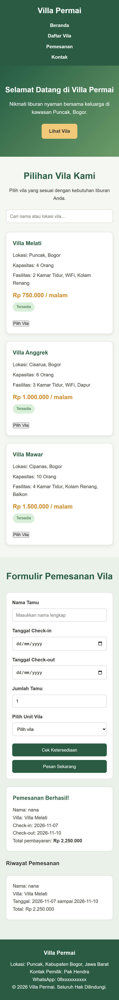

🏡 Villa Permai - Website Pemesanan Vila

Identitas Mahasiswa
Nama: Mardiana Ruhiayti
NIM: 24011130450

Deskripsi Proyek

Villa Permai merupakan website pemesanan vila yang berlokasi di kawasan Puncak, Kabupaten Bogor, Jawa Barat.

Website ini dibuat untuk memudahkan pengunjung melihat pilihan vila dan melakukan simulasi pemesanan secara online.

Teknologi yang Digunakan

- HTML
- CSS
- JavaScript

Fitur Website

1. Halaman Beranda
2. Daftar pilihan vila
3. Pencarian vila berdasarkan nama atau lokasi
4. Formulir pemesanan vila
5. Pengecekan ketersediaan vila
6. Ringkasan biaya pemesanan
7. Tampilan responsif

Struktur Folder

Uts_vila_permai/
│
├── index.html
├── style.css
├── script.js
└── README.md

Identitas Proyek

- Nama Proyek: Villa Permai
- Lokasi: Puncak, Kabupaten Bogor
- Pemilik Vila: Pak Hendra
- Tahun: 2026

Dokumentasi

## Dokumentasi

GitHub Repository

https://github.com/mardianaruhiyati2024-creator/Uts_vila_permai
